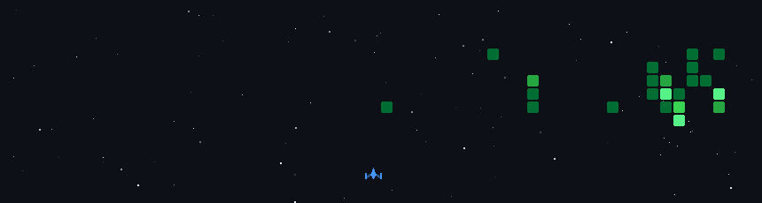

🎮 Desenvolvedor apaixonado por código e jogos 
💼 Desenvolvendo soluções no trabalho e em projetos pessoais 
🌱 Sempre aprendendo algo novo 
📈 Cada contribuição vira munição para a nave 🚀

---

<h2 align="center">👾 Minhas contribuições viraram um jogo</h2>

  

---

<h2 align="center">📊 Estatísticas</h2>

  <!-- Imagens geradas todo dia pelo workflow metrics.yml -->
  
   
  

---

<h2 align="center">🚀 Minha nave (Tech Stack)</h2>

  
   
  

---

<h2 align="center">☠️ Inimigo nº 1</h2>

  
   
  <b>JAVASCRIPT</b> — nível de ameaça: <code>undefined</code> 👾 
  <i>"[] + {}" ... nem a nave entendeu.</i>
    
  
  

---

  
    
  ⭐ Se curtir algum projeto, deixa uma estrela!

